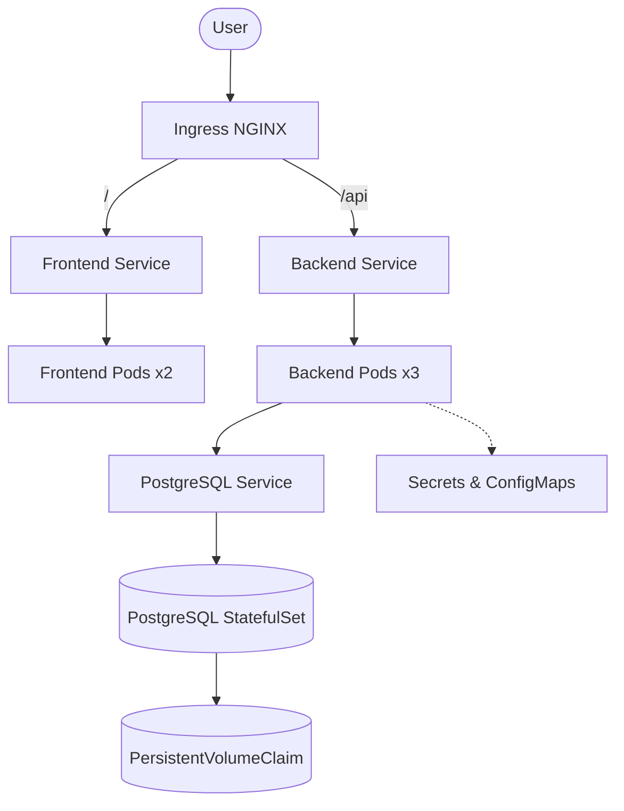
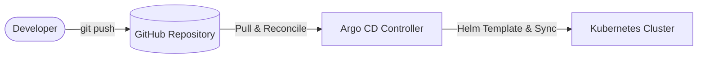
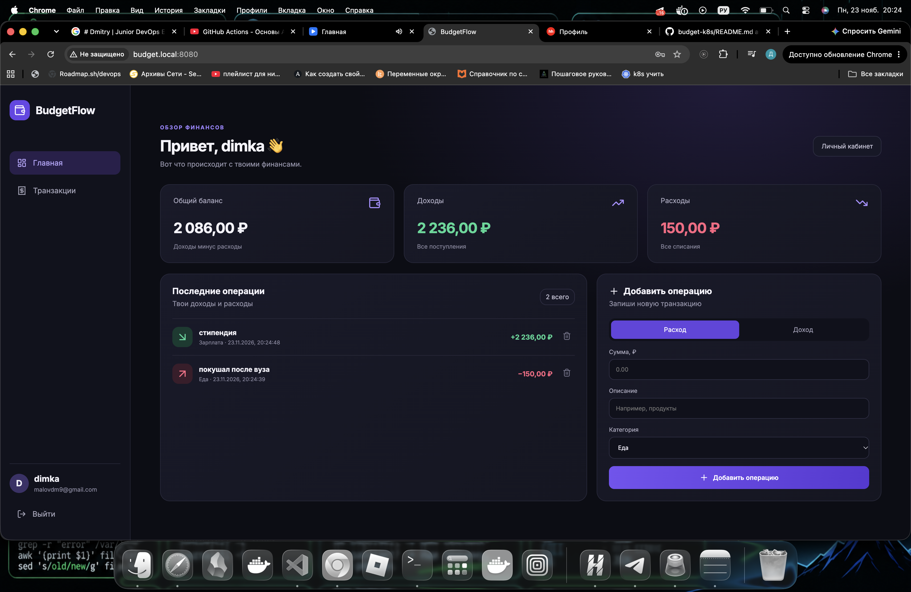
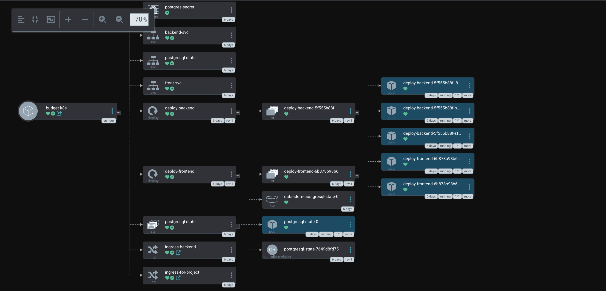

# budgetflow

# BudgetFlow

**BudgetFlow** — веб-приложение для учёта личных финансов. Проект разработан как практическая площадка для изучения DevOps-инструментов, контейнеризации и оркестрации приложений в Kubernetes.

Основной акцент — автоматизация инфраструктуры и развёртывания приложения с помощью **Docker, Kubernetes и Helm**.

---

## Architecture

### Runtime & Traffic Flow


### GitOps Delivery Flow


### Application & Infrastructure Stack

| Layer | Component | Technology |
| :--- | :--- | :--- |
| **Frontend** | User Interface | React, TypeScript, Vite |
| **Backend** | REST API & Logic | Python, FastAPI |
| **Database** | Persistent Storage | PostgreSQL (`StatefulSet` + `PVC`) |
| **Networking** | Routing & Load Balancing | NGINX Ingress Controller, K8s Services |
| **Packaging** | Templating & Releases | Helm Charts |
| **GitOps / CD** | Continuous Delivery | Argo CD |
| **Platform** | Orchestration & Runtime | Kubernetes (`kind`), Docker |

### Key Architectural Highlights
* **High Availability:** Stateless-компоненты масштабированы на несколько реплик (3 пода `backend` и 2 пода `frontend`) с балансировкой трафика через внутренние `ClusterIP` сервисы.
* **Stateful Persistence:** База данных PostgreSQL развернута через `StatefulSet` с привязанным `PersistentVolumeClaim`, что гарантирует сохранность данных при перезапуске или пересоздании подов.
* **Declarative GitOps:** Состояние кластера полностью описано в Helm-чарте и синхронизируется с Git-репозиторием через **Argo CD** (`self-heal` и `prune`), исключая ручные правки в кластере.


---

## Infrastructure

Приложение разделено на несколько независимых компонентов:

- **Frontend** — пользовательский интерфейс.
- **Backend** — REST API и бизнес-логика.
- **PostgreSQL** — постоянное хранение данных.
- **Ingress NGINX** — маршрутизация внешнего трафика.
- **Kubernetes Services** — внутренняя сетевая доступность компонентов.

Каждый компонент разворачивается в Kubernetes и взаимодействует с остальными через внутреннюю сеть кластера.

---

## Helm

Для автоматизации развёртывания Kubernetes-манифесты постепенно переносятся в Helm Chart.

Цель — отказаться от ручного применения множества YAML-файлов и получить возможность разворачивать всё приложение одной командой.

```bash
helm upgrade --install budgetflow ./budget-chart \
  -n budgetflow --create-namespace
```

### Helm Chart structure

```text
budget-chart/
├── Chart.yaml
├── values.yaml
└── templates/
    ├── deployment-frontend.yaml
    ├── deployment-backend.yaml
    ├── service.yaml
    ├── ingress-backend.yaml
    ├── ingress-frontend.yaml
    ├── secrets-data.yaml
    ├── stateful-db.yaml
    ├── svc-database.yaml
    └── svc.yaml (Go templates)
```

Конфигурация компонентов хранится в `values.yaml`, а Helm Templates позволяют генерировать Kubernetes-манифесты на основе общих шаблонов.

Например, несколько Kubernetes Service можно создавать с помощью одного шаблона и конструкции `range`.

---

## Deployment

Проверка сгенерированных манифестов:

```bash
helm template budgetflow ./budget-chart
```

Установка или обновление приложения:

```bash
helm upgrade --install budgetflow budget-chart/ 
```
Поды для фронтенда в namespace: frontend 
Поды для бекенда: postgresql, backend, ingress; в namespace: backend
Проверка ресурсов:

```bash
kubectl get pods,svc,deploy -n frontend/backend
```

---

## Project goals

- [x] Разработка многокомпонентного приложения.
- [x] Контейнеризация компонентов с помощью Docker.
- [x] Первичное развёртывание в Kubernetes.
- [x] Перенос Kubernetes-манифестов в Helm.
- [ ] Единая команда для развёртывания приложения.
- [x] Автоматизация сборки Docker-образов через GitLab CI/CD.
- [x] GitOps-развёртывание с помощью Argo CD.
- [ ] Мониторинг приложения через Prometheus и Grafana.

---

## What I'm learning

В процессе разработки проекта изучаю и практикую:

- Kubernetes Deployments, Services, StatefulSets и Ingress.
- ConfigMaps, Secrets и PersistentVolumeClaims.
- Helm Charts, Go Templates, `range`, `include` и `values.yaml`.
- Контейнеризацию и управление Docker-образами.
- Автоматизацию CI/CD.
- GitOps-подход к управлению инфраструктурой.

---

**BudgetFlow is a hands-on DevOps learning project.**

The main goal is to understand how application components, containers, Kubernetes resources and deployment automation work together.

Результат: 

Все данные о пользователе сохраняются, даже после перезапуска приложения всё будет на месте 




GitOps Arhitecture: 

