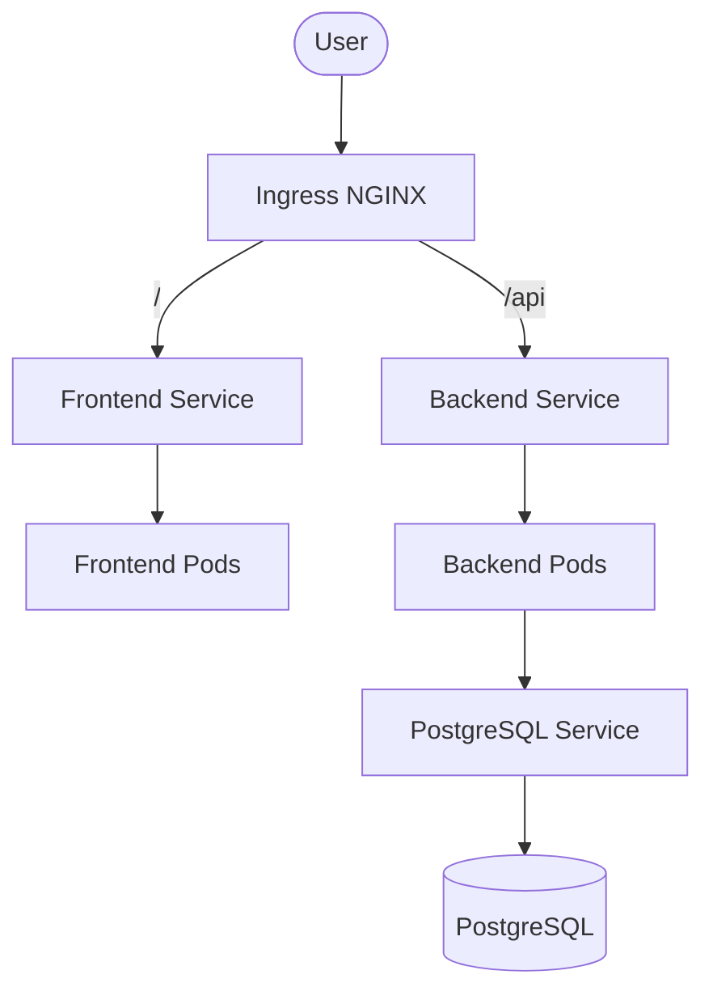

# budgetflow

# BudgetFlow

**BudgetFlow** — веб-приложение для учёта личных финансов. Проект разработан как практическая площадка для изучения DevOps-инструментов, контейнеризации и оркестрации приложений в Kubernetes.

Основной акцент — автоматизация инфраструктуры и развёртывания приложения с помощью **Docker, Kubernetes и Helm**.

---

## Architecture



### Application stack

| Component          | Technology               |
| ------------------ | ------------------------ |
| Frontend           | React, TypeScript, Vite  |
| Backend            | Python, FastAPI          |
| Database           | PostgreSQL               |
| Containerization   | Docker                   |
| Orchestration      | Kubernetes               |
| Package management | Helm                     |
| Ingress            | NGINX Ingress Controller |

---

## Infrastructure

Приложение разделено на несколько независимых компонентов:

- **Frontend** — пользовательский интерфейс.
- **Backend** — REST API и бизнес-логика.
- **PostgreSQL** — постоянное хранение данных.
- **Ingress NGINX** — маршрутизация внешнего трафика.
- **Kubernetes Services** — внутренняя сетевая доступность компонентов.

Каждый компонент разворачивается в Kubernetes и взаимодействует с остальными через внутреннюю сеть кластера.

---

## Helm

Для автоматизации развёртывания Kubernetes-манифесты постепенно переносятся в Helm Chart.

Цель — отказаться от ручного применения множества YAML-файлов и получить возможность разворачивать всё приложение одной командой.

```bash
helm upgrade --install budgetflow ./budgetflow-chart \
  -n budgetflow --create-namespace
```

### Helm Chart structure

```text
budgetflow-chart/
├── Chart.yaml
├── values.yaml
└── templates/
    ├── frontend-deployment.yaml
    ├── backend-deployment.yaml
    ├── service.yaml
    ├── postgresql-statefulset.yaml
    ├── ingress.yaml
    ├── configmap.yaml
    └── secret.yaml
```

Конфигурация компонентов хранится в `values.yaml`, а Helm Templates позволяют генерировать Kubernetes-манифесты на основе общих шаблонов.

Например, несколько Kubernetes Service можно создавать с помощью одного шаблона и конструкции `range`.

---

## Deployment

Проверка сгенерированных манифестов:

```bash
helm template budgetflow ./budgetflow-chart
```

Установка или обновление приложения:

```bash
helm upgrade --install budgetflow budget-chart/ 
```
Поды для фронтенда в namespace: frontend 
Поды для бекенда: postgresql, backend, ingress; в namespace: backend
Проверка ресурсов:

```bash
kubectl get pods,svc,deploy -n budgetflow
```

---

## Project goals

- [x] Разработка многокомпонентного приложения.
- [x] Контейнеризация компонентов с помощью Docker.
- [x] Первичное развёртывание в Kubernetes.
- [x] Перенос Kubernetes-манифестов в Helm.
- [ ] Единая команда для развёртывания приложения.
- [ ] Автоматизация сборки Docker-образов через GitLab CI/CD.
- [ ] GitOps-развёртывание с помощью Argo CD.
- [ ] Мониторинг приложения через Prometheus и Grafana.

---

## What I'm learning

В процессе разработки проекта изучаю и практикую:

- Kubernetes Deployments, Services, StatefulSets и Ingress.
- ConfigMaps, Secrets и PersistentVolumeClaims.
- Helm Charts, Go Templates, `range`, `include` и `values.yaml`.
- Контейнеризацию и управление Docker-образами.
- Автоматизацию CI/CD.
- GitOps-подход к управлению инфраструктурой.

---

**BudgetFlow is a hands-on DevOps learning project.**

The main goal is to understand how application components, containers, Kubernetes resources and deployment automation work together.

Результат: 

Все данные о пользователе сохраняются, даже после перезапуска приложения всё будет на месте 


GitOps Arhitecture: 